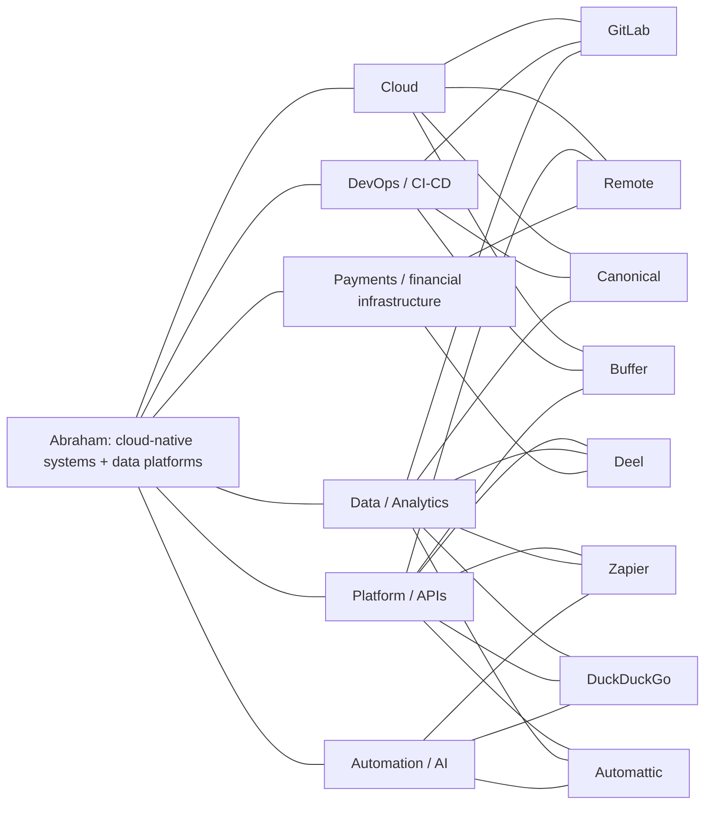
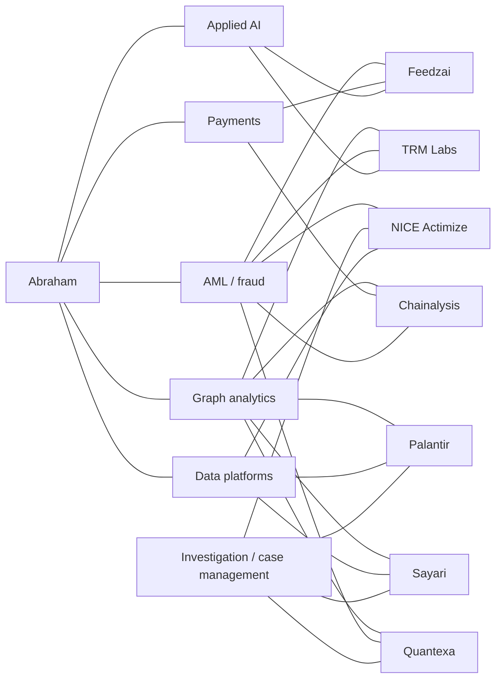
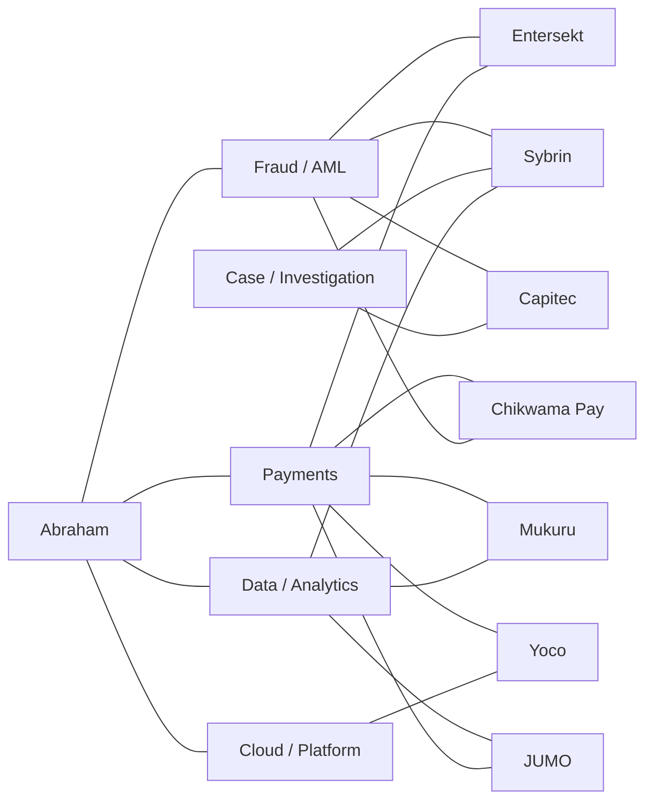

# Remote Company Radar

**Prepared:** 14 October 2026  
**Candidate base:** Abraham Kapambwe — Pretoria, South Africa  
**Profile used:** .NET/C#, cloud platforms, Microsoft Fabric, Spark, Power BI, DevOps, infrastructure as code, payments, graph analytics, AML/fraud, and applied AI.

## How to use this list

This is a prioritization shortlist, not a guarantee that every role can be hired from South Africa. Remote policies and job eligibility can vary by role, legal entity, time zone, and country. Before applying, verify the specific opening on the company’s official careers page.

## Initial target list

| Priority | Company | Remote model / evidence | Strongest profile overlap | Apply / verify |
|---:|---|---|---|---|
| 1 | **GitLab** | All-remote; GitLab describes an all-remote model with no preferred time zone. | DevOps, CI/CD, cloud infrastructure, async engineering | [Jobs](https://about.gitlab.com/jobs/) · [All-remote handbook](https://about.gitlab.com/handbook/company/culture/all-remote/) |
| 2 | **Remote** | Distributed global team working across six continents. | Payments, global employment infrastructure, APIs, platform engineering | [Open roles](https://remote.com/openings) · [Careers](https://remote.com/careers) |
| 3 | **Deel** | Fully remote global team; its culture page describes a remote-first operating model. | Global payroll, APIs, data platforms, financial operations | [Careers](https://www.deel.com/careers/) · [Culture](https://www.deel.com/our-culture/) |
| 4 | **Canonical** | Remote-first and fully distributed since 2004; some roles involve travel and customer presence. | Linux/open infrastructure, cloud, Kubernetes, DevOps, distributed systems | [Careers](https://canonical.com/careers) · [Remote work policy](https://canonical.com/careers/company-culture/remote-work) |
| 5 | **Zapier** | Remote-first since 2011 with a distributed culture. | Automation, integrations, AI, platform engineering, data workflows | [Jobs](https://zapier.com/jobs) |
| 6 | **DuckDuckGo** | Remote company with a distributed team and no core hours; role location still needs checking. | Privacy, backend systems, analytics, AI/data pipelines | [Hiring](https://duckduckgo.com/hiring) |
| 7 | **Automattic** | Work-from-anywhere model across a globally distributed team. | Platforms, commerce, open web, async collaboration, payments | [Jobs](https://automattic.com/work-with-us/jobs/) · [Work with us](https://automattic.com/work-with-us/) |
| 8 | **Buffer** | Fully remote team; current engineering roles emphasize remote work and EMEA overlap. | Infrastructure, CI/CD, developer tooling, cloud, product platforms | [Open roles](https://buffer.com/journey) · [Remote team](https://buffer.com/journey) |

## Graph analysis

The graph treats the candidate’s strongest capabilities as shared nodes. A company is connected to a capability when its remote-company evidence and public career material suggest a meaningful overlap. The fit score is a practical ranking heuristic, not a probability of being hired.

### What the graph suggests

1. **Highest-density cluster — infrastructure and platforms:** GitLab, Remote, Deel, and Canonical share the largest number of edges with cloud, DevOps, data, and platform capabilities. These should be the first research targets.
2. **Strong domain bridge — payments and global work infrastructure:** Remote and Deel are particularly relevant because the candidate has payment-provider and financial-platform experience, not only generic software experience.
3. **Automation and applied AI lane:** Zapier, DuckDuckGo, and Automattic connect well to automation, AI, data, and platform work. These are good targets for an application narrative centered on intelligent systems and data products.
4. **DevOps-focused option:** Buffer has fewer domain overlaps but a clear infrastructure and CI/CD connection, making it a focused target for platform or infrastructure roles.
5. **Geographic filter:** Canonical explicitly mentions Cape Town sprints, and Buffer’s current engineering role mentions EMEA overlap. These are useful signals for a South Africa-based search, but they do not replace checking each role’s hiring location.

## Investigator-systems track

These companies are more directly aligned with building software for investigators, intelligence analysts, financial-crime teams, regulators, law enforcement, or security operations than the general remote-company list above.

| Priority | Company | Investigator system focus | Remote signal | Why it fits your profile |
|---:|---|---|---|---|
| 1 | **[Quantexa](https://www.quantexa.com/careers/)** | Decision intelligence, entity resolution, graph analytics, financial-crime and intelligence-led investigations. | Remote work is possible when necessary; current openings are often location-specific. | Closest match to your graph-first AML project, Fabric/data-platform work, and risk decisioning. |
| 2 | **[Sayari](https://sayari.com/careers/)** | Entity knowledge graph, ownership-chain traversal, trade intelligence, risk intelligence, and investigative tools for analysts. | Current listings include “Anywhere” and several remote roles, but many roles are US/UK/region restricted. | Excellent match for graph analytics, entity resolution, global trade, AML, and source-cited intelligence. |
| 3 | **[TRM Labs](https://www.trmlabs.com/careers)** | AI investigations, blockchain intelligence, threat networks, case building, and crime disruption. | Current careers page exposes remote roles in engineering, data, intelligence, and investigations; eligibility is commonly region-specific. | Strong match for payments, fraud, graph analytics, AI, and investigator-facing systems. |
| 4 | **[Chainalysis](https://www.chainalysis.com/careers/)** | Blockchain analytics and investigation/compliance tools used by agencies, regulators, banks, and financial institutions. | Has an explicit remote employee squad and remote benefits; role and country eligibility must be checked. | Strong match for financial crime, transaction networks, payments, and data analytics. |
| 5 | **[Feedzai](https://careers.feedzai.com/)** | Cloud financial-risk platform using machine learning to combat fraud and financial crime. | Explicit Flex/Remote policy; current roles span multiple countries. | Strong match for real-time payments, fraud detection, ML, cloud systems, and risk platforms. |
| 6 | **[NICE Actimize](https://www.nice.com/careers/apply?q=net)** | Financial-crime detection, investigation management, case management, communications surveillance, and risk/compliance software. | Fully remote roles exist mainly for customer-facing positions; other roles use hybrid NiCE-FLEX. | Strong enterprise fit for AML, investigations, case workflows, DevOps, and financial-services platforms. |
| 7 | **[Palantir](https://www.palantir.com/careers/open-positions/)** | Investigative and intelligence platforms for government, defense, security, and commercial organizations. | Current investigation-related engineering roles are frequently office, hybrid, or country/security restricted. | High technical and mission fit for graph/data integration and investigator workflows, but lower remote accessibility. |

### Investigator-systems graph

### Interpretation

- **Best direct match:** Quantexa and Sayari. Both make graph/entity intelligence central to the product rather than treating it as a supporting feature.
- **Best remote-plus-investigator combination:** TRM Labs and Chainalysis, subject to country restrictions. Their platforms explicitly support investigations into illicit financial activity and threat networks.
- **Best payments/fraud route:** Feedzai and NICE Actimize. These are especially relevant if you want to position yourself as a financial-crime platform engineer rather than only a general software developer.
- **Best high-mission stretch target:** Palantir. The technical overlap is high, but remote accessibility and government/security constraints make it a more selective route.

### Recommended application order for this track

1. **Quantexa** — lead with graph-first AML, entity resolution, and contextual decision intelligence.
2. **Sayari** — lead with knowledge graphs, hidden relationships, trade intelligence, and source-grounded analysis.
3. **TRM Labs** — lead with payments, fraud networks, AI, graph analytics, and real-time investigation workflows.
4. **Feedzai** — lead with payment-provider integrations, risk scoring, and cloud-native data systems.
5. **Chainalysis** — lead with transaction networks, financial crime, and investigative analytics.
6. **NICE Actimize** — lead with financial-services engineering, case management, and compliance workflows.
7. **Palantir** — lead with graph/data integration, mission-critical systems, and investigator-facing product thinking.

## South Africa application track

These companies are either South African employers or have clearly identified South African roles. They are especially useful if the immediate goal is to secure a local or South Africa-based opportunity while staying close to investigator, fraud, payments, risk, and data-platform work.

| Priority | Company | South Africa signal | Product / investigator relevance | Apply / verify |
|---:|---|---|---|---|
| 1 | **[Entersekt](https://www.entersekt.com/why-entersekt/careers)** | Stellenbosch-based South Africa office; current listings include **Senior Software Engineer: 3DS Payments — Fully Remote, South Africa** and a remote QE/Automation lead role. | Digital banking fraud prevention, payment security, authentication, and real-time risk decisioning. | [Current roles](https://job-boards.greenhouse.io/entersekt) |
| 2 | **[Sybrin](https://sybrin.com/)** | Johannesburg-headquartered enterprise software provider with a strong African footprint. | Compliance Workspace, KYC exceptions, AML screening matches, transaction-fraud alerts, case management, and transaction monitoring. | [Company site](https://sybrin.com/) · [Compliance Workspace](https://sybrin.com/digital-onboarding-service/compliance-workspace/) |
| 3 | **[Mukuru](https://www.mukuru.com/about-us/careers/)** | South African fintech with Cape Town contact base and active careers page. | Cross-border payments, money movement, financial inclusion, operational risk, and transaction data at African scale. | [Careers](https://www.mukuru.com/about-us/careers/) |
| 4 | **[Yoco](https://www.yoco.com/za/careers/)** | Teams across South Africa and the Netherlands; explicitly hybrid, with Johannesburg and Cape Town offices. | Payments, merchant platforms, financial products, fraud/risk controls, and data-driven SME tooling. | [Careers and open roles](https://www.yoco.com/za/careers/) |
| 5 | **[JUMO](https://jumo.world/careers/)** | Current careers page lists South Africa permanent roles, including Software Engineer and Customer Data Scientist. | Mobile financial technology, lending, customer data, prediction, and scalable financial platforms. | [Careers](https://jumo.world/careers/) |
| 6 | **[Capitec](https://careers.capitecbank.co.za/)** | South African bank with current local fraud-operations openings. | Fraud operations, chargebacks, digital banking, risk controls, and investigator-facing financial processes. | [Careers](https://careers.capitecbank.co.za/) · [Fraud operations example](https://careers.capitecbank.co.za/job/Century-City-Consultant-Fraud-Operations-%28Chargebacks%29-WC/1446121933/) |
| 7 | **[Chikwama Pay](https://www.chikwamapay.com/careers)** | Southern Africa-focused fintech; general applications are welcomed by email. | Payments, risk, fraud, AML, compliance, API integrations, and underserved-market financial systems. | [Careers](https://www.chikwamapay.com/careers/) |

### Best local matches for your current profile

- **Entersekt:** strongest immediate fit for payment security, fraud prevention, .NET/cloud engineering, and a remote South Africa role.
- **Sybrin:** strongest product-domain fit for building investigator and compliance workflows in a South African enterprise-software environment.
- **Yoco:** strongest fit for modern payments, platform engineering, and hybrid work in South Africa.
- **Mukuru:** strongest fit for cross-border payments, Africa-scale systems, and operational data.
- **JUMO:** strongest fit for data engineering, customer analytics, lending, and financial decisioning.

### South Africa graph additions

### Local application sequence

1. **Entersekt** — apply to the South Africa remote 3DS/payment and QA automation roles first.
2. **Sybrin** — submit a targeted application or contact the company with a short investigator-platform portfolio note.
3. **Yoco and Mukuru** — search engineering, platform, data, fraud, risk, and payments roles weekly.
4. **JUMO** — target Software Engineer, Customer Data Scientist, data platform, and lending/risk roles.
5. **Capitec** — monitor fraud, digital banking, data engineering, and platform roles.
6. **Chikwama Pay** — send a direct application emphasizing payments, compliance-aware APIs, and risk/fraud systems.

## Suggested application sequence

### Tier 1 — apply first

- GitLab
- Remote
- Deel
- Canonical

### Tier 2 — tailor toward automation, AI, and product platforms

- Zapier
- DuckDuckGo
- Automattic

### Tier 3 — infrastructure-focused watchlist

- Buffer

## Tailoring angles

| Company cluster | Lead with | Proof to bring forward |
|---|---|---|
| GitLab / Canonical / Buffer | Reliability, delivery automation, and infrastructure | Azure/AWS/GCP, Docker, Kubernetes, Terraform, Azure DevOps, CI/CD |
| Remote / Deel | Financial and operational systems at global scale | 20+ payment providers, real-time payments, BaaS, APIs, risk intelligence |
| Zapier / Automattic | Product platforms and automation | .NET systems, integrations, event-driven architecture, applied AI |
| DuckDuckGo | Privacy-aware data and backend engineering | Graph analytics, AML/fraud intelligence, Spark, Power BI, data pipelines |

## Next update fields

When a specific role is found, add these fields below the company row or in a separate tracker:

- Role title and URL
- Country eligibility / time-zone requirement
- Employment type
- Match score against the role description
- Resume variant used
- Date applied and follow-up date
- Stage and outcome

## International expansion — 15 October 2026

This section consolidates the additional international companies identified during the latest search. It is an application target bank, not a guarantee that every company can employ someone in South Africa. Check the location, timezone, payroll, and right-to-work requirements on each specific advert.

### Additional international companies

| Company | Best-fit track | Apply / verify |
|---|---|---|
| **Elastic** | Search, observability, security, cloud engineering, data platforms | [Careers](https://jobs.elastic.co/) |
| **Automattic** | Backend, systems, security, payments, platform engineering | [Jobs](https://automattic.com/work-with-us/jobs/) |
| **Grafana Labs** | Observability, Kubernetes, backend, cloud, data engineering | [Careers](https://grafana.com/careers/) |
| **HashiCorp / IBM** | Terraform, cloud infrastructure, identity, DevOps | [Open positions](https://www.hashicorp.com/careers/open-positions) |
| **Snyk** | DevSecOps, application security, cloud security | [Careers](https://snyk.io/careers/) |
| **Mozilla** | Cloud engineering, infrastructure, security, open-source systems | [Open roles](https://www.mozilla.org/en-US/careers/listings/) |
| **Zapier** | Automation, integrations, AI, APIs, data workflows | [Jobs](https://zapier.com/jobs) |
| **GitHub** | Developer platforms, APIs, cloud infrastructure, security | [Careers](https://www.github.careers/) |
| **DuckDuckGo** | Privacy infrastructure, backend, security, AI/data | [Hiring](https://duckduckgo.com/hiring) |
| **Buffer** | Platform engineering, infrastructure, product systems | [Open roles](https://buffer.com/journey) |
| **Cloudflare** | Distributed systems, edge computing, networking, security | [Jobs](https://www.cloudflare.com/careers/jobs/) |
| **SUSE** | Linux, Kubernetes, cloud, enterprise infrastructure | [Careers](https://www.suse.com/careers/) |
| **Red Hat** | OpenShift, Kubernetes, Linux, middleware, DevOps | [Jobs](https://www.redhat.com/en/jobs) |
| **Mambu** | Banking platforms, fintech APIs, cloud-native systems | [Careers](https://www.mambu.com/careers) |
| **N26** | Digital banking, payments, fraud/risk, backend systems | [Careers](https://n26.com/en-eu/careers) |

### Cloud, data, and developer-platform targets

| Company | Best-fit track | Apply / verify |
|---|---|---|
| **Supabase** | PostgreSQL, platform engineering, cloud, data, security | [Careers](https://supabase.com/careers) |
| **Airwallex** | Payments, fintech infrastructure, APIs, financial partnerships | [Careers](https://www.airwallex.com/careers.html) |
| **Netlify** | Cloud platforms, DevOps, data, web infrastructure | [Careers](https://www.netlify.com/careers/) |
| **DigitalOcean** | Cloud infrastructure, PaaS, storage, platform engineering | [Open roles](https://www.digitalocean.com/careers/open-roles) |
| **Wise** | Payments, banking infrastructure, fraud, APIs, data | [Careers](https://wise.jobs/) |
| **Adyen** | Global payments, risk, fraud, backend, data | [Careers](https://careers.adyen.com/) |
| **Checkout.com** | Payment processing, APIs, financial infrastructure | [Careers](https://www.checkout.com/careers) |
| **Rapyd** | Payments-as-a-service, fintech APIs, money movement | [Careers](https://www.rapyd.net/company/careers/) |
| **GoCardless** | Open banking, payments, risk, platform engineering | [Careers](https://gocardless.com/careers/) |
| **Vercel** | Cloud platform, CDN, compute, observability, data platform | [Careers](https://vercel.com/careers) |
| **Fastly** | Edge cloud, networking, security, distributed systems | [Careers](https://www.fastly.com/about/careers) |
| **Vultr** | Cloud infrastructure, Kubernetes, SRE, data centers | [Careers](https://www.vultr.com/company/careers/) |
| **Fly.io** | Distributed cloud infrastructure, networking, Linux | [Jobs](https://fly.io/jobs/) |
| **Render** | Cloud infrastructure, deployment platforms, DevOps | [Careers](https://render.com/careers) |
| **Railway** | Developer cloud, deployment, infrastructure | [Careers](https://railway.app/careers) |

### Data-platform and observability targets

| Company | Best-fit track | Apply / verify |
|---|---|---|
| **Snowflake** | Data platforms, analytics engineering, cloud data | [Careers](https://careers.snowflake.com/) |
| **MongoDB** | Distributed databases, cloud services, data engineering | [Careers](https://www.mongodb.com/careers) |
| **Confluent** | Kafka, event streaming, real-time data platforms | [Careers](https://www.confluent.io/about/careers/) |
| **dbt Labs** | Analytics engineering, data transformation, cloud data | [Careers](https://www.getdbt.com/careers) |
| **Fivetran** | Data pipelines, connectors, cloud data engineering | [Careers](https://www.fivetran.com/careers) |
| **Astronomer** | Apache Airflow, orchestration, data engineering | [Careers](https://www.astronomer.io/careers/) |
| **Temporal** | Distributed workflows, backend, cloud systems | [Careers](https://temporal.io/careers) |
| **PlanetScale** | Databases, cloud infrastructure, developer tools | [Careers](https://planetscale.com/about#careers) |
| **ClickHouse** | Real-time analytics, cloud data infrastructure | [Careers](https://clickhouse.com/company/careers) |
| **DataStax** | NoSQL, cloud databases, AI data platforms | [Careers](https://www.datastax.com/company/careers) |
| **New Relic** | Monitoring, telemetry, cloud platforms, data engineering | [Careers](https://newrelic.com/about/careers) |
| **Sentry** | Application monitoring, backend, developer tools | [Careers](https://sentry.io/careers/) |
| **CircleCI** | CI/CD, developer platforms, cloud infrastructure | [Careers](https://circleci.com/careers/) |
| **LaunchDarkly** | Feature management, developer tools, cloud platforms | [Careers](https://launchdarkly.com/careers/) |
| **1Password** | Identity, security, cloud platforms, enterprise systems | [Careers](https://1password.com/careers) |
| **Okta** | Identity, APIs, security, cloud infrastructure | [Careers](https://www.okta.com/company/careers/) |
| **Aiven** | Managed Kafka, databases, cloud infrastructure | [Careers](https://aiven.io/careers) |

## Lesser-known specialist targets

These are smaller or more specialised companies where Abraham's payments, AML, graph, data-platform, and cloud experience may be especially distinctive.

### Fincrime, fraud, and risk specialists

| Company | Product fit | Apply / verify |
|---|---|---|
| **Lucinity** | AI-assisted AML and money-laundering investigations | [Work with Lucinity](https://lucinity.com/work-with-lucinity) |
| **Hawk AI** | AI-based AML, fraud, and transaction monitoring | [Careers](https://hawk.ai/careers) |
| **Tookitaki** | AI-driven AML, fraud prevention, and compliance | [Open positions](https://landingpage.tookitaki.ai/company/careers) |
| **Silent Eight** | AI for sanctions screening, AML investigations, and case narratives | [Open roles](https://silenteight.teamtailor.com/jobs/6775552-forward-deployed-ai-engineer-llm-ml-investigations-decisioning) |
| **Sardine** | Real-time fraud detection, identity, AML, and risk infrastructure | [Careers](https://jobs.ashbyhq.com/sardine) |
| **Unit21** | Transaction monitoring and fraud investigation tools | [Careers](https://unit21.ai/careers) |
| **Alloy** | Identity, fraud, onboarding, and risk decisioning | [Careers](https://www.alloy.com/careers) |
| **Oscilar** | AI-native credit risk and decisioning infrastructure | [Careers](https://www.oscilar.com/careers) |
| **Resistant AI** | Machine learning for fraud and document intelligence | [Careers](https://www.resistant.ai/careers) |
| **Flagright** | AML compliance automation and transaction monitoring | [Careers](https://www.flagright.com/careers) |
| **Cable** | Financial-crime compliance and fraud-risk management | [Careers](https://www.cable.tech/careers) |
| **DataVisor** | AI fraud detection and risk management | [Careers](https://www.datavisor.com/careers/) |
| **Ballerine** | Open-source KYC, KYB, onboarding, and risk infrastructure | [Careers](https://www.ballerine.com/careers) |
| **ComplyAdvantage** | AML screening, sanctions, fraud, and risk data | [Careers](https://complyadvantage.com/careers/) |

### Lesser-known data and cloud companies

| Company | Product fit | Apply / verify |
|---|---|---|
| **MotherDuck** | DuckDB cloud analytics and modern data platforms | [Careers](https://motherduck.com/careers/) |
| **Starburst** | Trino, data federation, data lakes, and query platforms | [Open roles](https://www.starburst.io/careers/open-roles/) |
| **Materialize** | Streaming SQL and real-time data infrastructure | [Careers](https://materialize.com/careers/) |
| **Redpanda Data** | Event streaming and real-time data infrastructure | [Careers](https://redpanda.com/careers) |
| **Prefect** | Workflow orchestration and data engineering | [Careers](https://www.prefect.io/careers) |
| **Dagster Labs** | Data orchestration, pipelines, and analytics engineering | [Careers](https://dagster.io/careers) |
| **Hex** | Collaborative notebooks, SQL, Python, and analytics | [Careers](https://hex.tech/careers/) |
| **Pulumi** | Infrastructure-as-code and cloud developer tools | [Careers](https://www.pulumi.com/careers/) |
| **Dagger** | Programmable CI/CD and developer infrastructure | [Careers](https://dagger.io/careers) |
| **Appsmith** | Open-source internal tools and developer platforms | [Careers](https://www.appsmith.com/careers) |
| **Replicated** | Enterprise software distribution and Kubernetes | [Careers](https://www.replicated.com/careers) |
| **Chainguard** | Secure containers and software supply-chain security | [Careers](https://www.chainguard.dev/careers) |
| **Aserto** | Authorization, identity, and cloud-native security | [Careers](https://www.aserto.com/careers) |
| **Oso** | Authorization infrastructure for applications | [Careers](https://www.osohq.com/careers) |
| **Doppler** | Secrets management and developer infrastructure | [Careers](https://www.doppler.com/careers) |
| **Tailscale** | Secure networking for distributed systems | [Careers](https://tailscale.com/careers) |

## Revised priority shortlist

For a South Africa-based search, start with companies whose adverts show South Africa, EMEA, global remote, or flexible international hiring. The strongest less-known targets are:

1. **Tookitaki** — direct AML/fraud fit; current listings have included remote data-science work.
2. **Lucinity** — direct match for AML, graph/contextual intelligence, and investigator workflows.
3. **Hawk AI** — fraud/AML product mission with an international team.
4. **Silent Eight** — strong match for AI-assisted financial-crime investigations.
5. **ClickHouse** — current cloud-data and EMEA remote engineering opportunities.
6. **MotherDuck** — strong modern analytics/data-platform match.
7. **Pulumi** — strong Terraform/cloud/infrastructure-as-code match.
8. **Supabase** — global-remote platform, database, and data engineering roles.
9. **Redpanda Data** — event streaming and real-time payments/data-platform relevance.
10. **Resistant AI** — fraud, document intelligence, and applied machine learning.

### Application positioning by specialist cluster

| Cluster | Lead with | Evidence to emphasize |
|---|---|---|
| AML / fraud / risk | Investigator-facing intelligence and explainable risk decisions | Financial Crime Intelligence Platform, graph analytics, payment providers, AML/fraud concepts |
| Data platforms | Reliable ingestion, transformation, analytics, and operational data products | Fabric, Spark, Databricks, SQL, Power BI, graph databases |
| Cloud / DevOps | Production reliability and repeatable delivery | Azure/AWS/GCP, Docker, Kubernetes, Terraform, Azure DevOps, CI/CD |
| Fintech infrastructure | Secure, scalable APIs and real-time transaction systems | Real-Time Payments Platform, BaaS, 20+ payment-provider integrations, .NET |
| Developer tools | Platform thinking and developer experience | Scalable .NET systems, automation, APIs, CI/CD, infrastructure-as-code |

