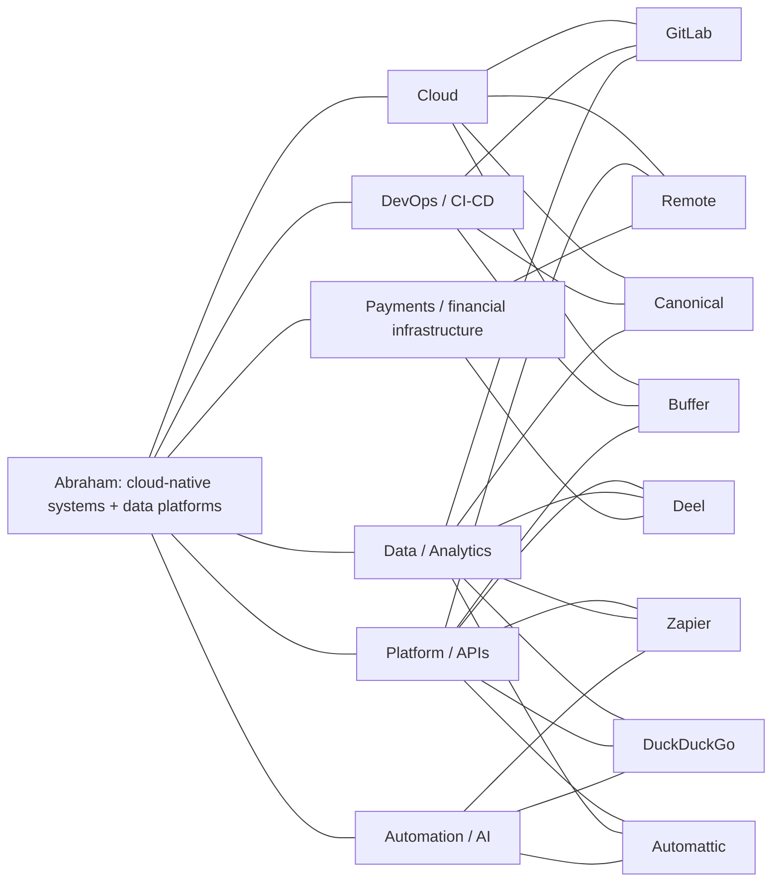
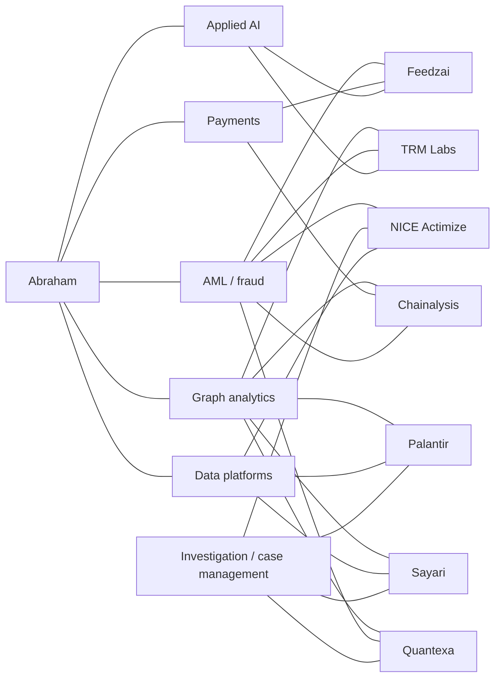

# Remote Company Radar

**Prepared:** 14 October 2026  
**Candidate base:** Abraham Kapambwe — Pretoria, South Africa  
**Profile used:** .NET/C#, cloud platforms, Microsoft Fabric, Spark, Power BI, DevOps, infrastructure as code, payments, graph analytics, AML/fraud, and applied AI.

## How to use this list

This is a prioritization shortlist, not a guarantee that every role can be hired from South Africa. Remote policies and job eligibility can vary by role, legal entity, time zone, and country. Before applying, verify the specific opening on the company’s official careers page.

## Initial target list

| Priority | Company | Remote model / evidence | Strongest profile overlap | Apply / verify |
|---:|---|---|---|---|
| 1 | **GitLab** | All-remote; GitLab describes an all-remote model with no preferred time zone. | DevOps, CI/CD, cloud infrastructure, async engineering | [Jobs](https://about.gitlab.com/jobs/) · [All-remote handbook](https://about.gitlab.com/handbook/company/culture/all-remote/) |
| 2 | **Remote** | Distributed global team working across six continents. | Payments, global employment infrastructure, APIs, platform engineering | [Open roles](https://remote.com/openings) · [Careers](https://remote.com/careers) |
| 3 | **Deel** | Fully remote global team; its culture page describes a remote-first operating model. | Global payroll, APIs, data platforms, financial operations | [Careers](https://www.deel.com/careers/) · [Culture](https://www.deel.com/our-culture/) |
| 4 | **Canonical** | Remote-first and fully distributed since 2004; some roles involve travel and customer presence. | Linux/open infrastructure, cloud, Kubernetes, DevOps, distributed systems | [Careers](https://canonical.com/careers) · [Remote work policy](https://canonical.com/careers/company-culture/remote-work) |
| 5 | **Zapier** | Remote-first since 2011 with a distributed culture. | Automation, integrations, AI, platform engineering, data workflows | [Jobs](https://zapier.com/jobs) |
| 6 | **DuckDuckGo** | Remote company with a distributed team and no core hours; role location still needs checking. | Privacy, backend systems, analytics, AI/data pipelines | [Hiring](https://duckduckgo.com/hiring) |
| 7 | **Automattic** | Work-from-anywhere model across a globally distributed team. | Platforms, commerce, open web, async collaboration, payments | [Jobs](https://automattic.com/work-with-us/jobs/) · [Work with us](https://automattic.com/work-with-us/) |
| 8 | **Buffer** | Fully remote team; current engineering roles emphasize remote work and EMEA overlap. | Infrastructure, CI/CD, developer tooling, cloud, product platforms | [Open roles](https://buffer.com/journey) · [Remote team](https://buffer.com/journey) |

## Graph analysis

The graph treats the candidate’s strongest capabilities as shared nodes. A company is connected to a capability when its remote-company evidence and public career material suggest a meaningful overlap. The fit score is a practical ranking heuristic, not a probability of being hired.

### What the graph suggests

1. **Highest-density cluster — infrastructure and platforms:** GitLab, Remote, Deel, and Canonical share the largest number of edges with cloud, DevOps, data, and platform capabilities. These should be the first research targets.
2. **Strong domain bridge — payments and global work infrastructure:** Remote and Deel are particularly relevant because the candidate has payment-provider and financial-platform experience, not only generic software experience.
3. **Automation and applied AI lane:** Zapier, DuckDuckGo, and Automattic connect well to automation, AI, data, and platform work. These are good targets for an application narrative centered on intelligent systems and data products.
4. **DevOps-focused option:** Buffer has fewer domain overlaps but a clear infrastructure and CI/CD connection, making it a focused target for platform or infrastructure roles.
5. **Geographic filter:** Canonical explicitly mentions Cape Town sprints, and Buffer’s current engineering role mentions EMEA overlap. These are useful signals for a South Africa-based search, but they do not replace checking each role’s hiring location.

## Investigator-systems track

These companies are more directly aligned with building software for investigators, intelligence analysts, financial-crime teams, regulators, law enforcement, or security operations than the general remote-company list above.

| Priority | Company | Investigator system focus | Remote signal | Why it fits your profile |
|---:|---|---|---|---|
| 1 | **[Quantexa](https://www.quantexa.com/careers/)** | Decision intelligence, entity resolution, graph analytics, financial-crime and intelligence-led investigations. | Remote work is possible when necessary; current openings are often location-specific. | Closest match to your graph-first AML project, Fabric/data-platform work, and risk decisioning. |
| 2 | **[Sayari](https://sayari.com/careers/)** | Entity knowledge graph, ownership-chain traversal, trade intelligence, risk intelligence, and investigative tools for analysts. | Current listings include “Anywhere” and several remote roles, but many roles are US/UK/region restricted. | Excellent match for graph analytics, entity resolution, global trade, AML, and source-cited intelligence. |
| 3 | **[TRM Labs](https://www.trmlabs.com/careers)** | AI investigations, blockchain intelligence, threat networks, case building, and crime disruption. | Current careers page exposes remote roles in engineering, data, intelligence, and investigations; eligibility is commonly region-specific. | Strong match for payments, fraud, graph analytics, AI, and investigator-facing systems. |
| 4 | **[Chainalysis](https://www.chainalysis.com/careers/)** | Blockchain analytics and investigation/compliance tools used by agencies, regulators, banks, and financial institutions. | Has an explicit remote employee squad and remote benefits; role and country eligibility must be checked. | Strong match for financial crime, transaction networks, payments, and data analytics. |
| 5 | **[Feedzai](https://careers.feedzai.com/)** | Cloud financial-risk platform using machine learning to combat fraud and financial crime. | Explicit Flex/Remote policy; current roles span multiple countries. | Strong match for real-time payments, fraud detection, ML, cloud systems, and risk platforms. |
| 6 | **[NICE Actimize](https://www.nice.com/careers/apply?q=net)** | Financial-crime detection, investigation management, case management, communications surveillance, and risk/compliance software. | Fully remote roles exist mainly for customer-facing positions; other roles use hybrid NiCE-FLEX. | Strong enterprise fit for AML, investigations, case workflows, DevOps, and financial-services platforms. |
| 7 | **[Palantir](https://www.palantir.com/careers/open-positions/)** | Investigative and intelligence platforms for government, defense, security, and commercial organizations. | Current investigation-related engineering roles are frequently office, hybrid, or country/security restricted. | High technical and mission fit for graph/data integration and investigator workflows, but lower remote accessibility. |

### Investigator-systems graph

### Interpretation

- **Best direct match:** Quantexa and Sayari. Both make graph/entity intelligence central to the product rather than treating it as a supporting feature.
- **Best remote-plus-investigator combination:** TRM Labs and Chainalysis, subject to country restrictions. Their platforms explicitly support investigations into illicit financial activity and threat networks.
- **Best payments/fraud route:** Feedzai and NICE Actimize. These are especially relevant if you want to position yourself as a financial-crime platform engineer rather than only a general software developer.
- **Best high-mission stretch target:** Palantir. The technical overlap is high, but remote accessibility and government/security constraints make it a more selective route.

### Recommended application order for this track

1. **Quantexa** — lead with graph-first AML, entity resolution, and contextual decision intelligence.
2. **Sayari** — lead with knowledge graphs, hidden relationships, trade intelligence, and source-grounded analysis.
3. **TRM Labs** — lead with payments, fraud networks, AI, graph analytics, and real-time investigation workflows.
4. **Feedzai** — lead with payment-provider integrations, risk scoring, and cloud-native data systems.
5. **Chainalysis** — lead with transaction networks, financial crime, and investigative analytics.
6. **NICE Actimize** — lead with financial-services engineering, case management, and compliance workflows.
7. **Palantir** — lead with graph/data integration, mission-critical systems, and investigator-facing product thinking.

## Suggested application sequence

### Tier 1 — apply first

- GitLab
- Remote
- Deel
- Canonical

### Tier 2 — tailor toward automation, AI, and product platforms

- Zapier
- DuckDuckGo
- Automattic

### Tier 3 — infrastructure-focused watchlist

- Buffer

## Tailoring angles

| Company cluster | Lead with | Proof to bring forward |
|---|---|---|
| GitLab / Canonical / Buffer | Reliability, delivery automation, and infrastructure | Azure/AWS/GCP, Docker, Kubernetes, Terraform, Azure DevOps, CI/CD |
| Remote / Deel | Financial and operational systems at global scale | 20+ payment providers, real-time payments, BaaS, APIs, risk intelligence |
| Zapier / Automattic | Product platforms and automation | .NET systems, integrations, event-driven architecture, applied AI |
| DuckDuckGo | Privacy-aware data and backend engineering | Graph analytics, AML/fraud intelligence, Spark, Power BI, data pipelines |

## Next update fields

When a specific role is found, add these fields below the company row or in a separate tracker:

- Role title and URL
- Country eligibility / time-zone requirement
- Employment type
- Match score against the role description
- Resume variant used
- Date applied and follow-up date
- Stage and outcome

